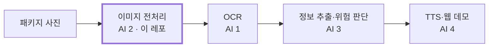

# package-ocr-preprocessing

> 딥러닝 2026-2학기 Team 05 · AI 2 (이미지 전처리) · 담당: 배창현

시각장애인이 찍은 패키지 사진은 반사광, 구김, 흔들림, 어두운 조명 때문에 OCR이 자주 틀립니다.
이 레포는 **촬영 환경별로 OCR이 얼마나 틀리는지 분석하고, 전처리로 얼마나 개선되는지 비교**하는 실험을 담고 있습니다.

## 전체 시스템에서의 위치



## 폴더 구조

```
package-ocr-preprocessing/
├── preprocessing/    # 전처리·조건 생성·OCR 평가·실험 코드
├── notebooks/        # Colab 실험 노트북
├── data/
│   ├── raw/          # 직접 찍은 원본 사진 (올림)
│   ├── generated/    # 코드로 만든 사진 (올리지 않음, .gitignore)
│   └── labels/       # 정답 텍스트 라벨 (labels.csv)
├── results/          # 실험 결과 표·비교 이미지
├── docs/             # 모듈 간 인터페이스
└── requirements.txt
```

## 실행 방법

1. `data/raw/`에 사진을 올리고, `data/labels/labels.csv`에 정답을 적습니다.
2. Colab에서 `notebooks/ai2_week1_preprocess.ipynb`를 열고 위에서부터 차례로 실행합니다.
3. 결과는 `results/ai2_week1/`에 저장됩니다.

> 비공개 레포라면 Colab 왼쪽 열쇠 아이콘(보안 비밀)에 `GITHUB_TOKEN`으로 토큰을 저장해야 합니다. 코드에 토큰을 직접 붙여넣지 마세요.

## 다른 모듈에서 쓰는 법 (AI 4 통합용)

```python
import cv2
from preprocess import preprocess

img = cv2.imread("photo.jpg")
out = preprocess(img, ["clahe", "sharpen"])  # 원하는 기법을 순서대로
out = preprocess(img)                         # None이면 사진 품질을 보고 자동 선택
```

입출력 형식은 `docs/interface.md`를 참고하세요.

## 데이터 규칙

- 사진 파일 이름: `제품번호_조건ID_번호.jpg` (예: `p01_c0_1.jpg`, `p01_c2_3.jpg`)
- 코드로 만든 사진: 번호 대신 단계 표기 (예: `p01_c1_L1.jpg`)
- 정답 라벨은 제품별로 한 번만, **사진에 실제로 찍힌 글자만** 적습니다.

| 조건 ID | 조건 | 만드는 방법 | 제품당 장수 |
|---|---|---|---|
| C0 | 정상 (비교 기준) | 촬영 | 2 |
| C1 | 저조도 | 코드 생성 3단계 + 촬영 1장 | 3 + 1 |
| C2 | 반사광 | 촬영 | 3 |
| C3 | 흔들림 | 코드 생성 3단계 | 3 |
| C4 | 구김 | 촬영 | 3 |
| C5 | 작은 글씨·원거리 | 촬영 | 2 |

확장 조건(C6 회전, C7 곡면, C8 잘린 화면, C9 초점 흐림)은 2주차부터 다룹니다.

## 진행 상황

| 주차 | 기간 | 목표 | 상태 |
|---|---|---|---|
| 1주차 | 11/03 ~ 11/08 | 품질 문제 분석, 전처리 기법 조사, 기본 전처리 구현 | 진행 중 |
