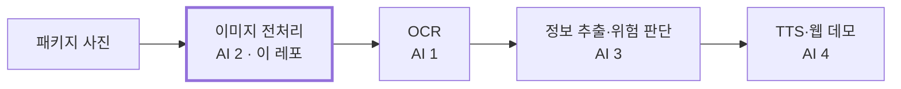

# package-ocr-preprocessing

> 딥러닝 2026-2학기 Team 05 · AI 2 (이미지 전처리) · 담당: 배창현

시각장애인이 찍은 패키지 사진은 반사광, 구김, 흔들림, 어두운 조명 때문에 OCR이 자주 틀립니다.
이 레포는 **촬영 환경별로 OCR이 얼마나 틀리는지 분석하고, 전처리로 얼마나 개선되는지 비교**하는 실험을 담고 있습니다.

## 전체 시스템에서의 위치



## 폴더 구조

```
package-ocr-preprocessing/
├── preprocessing/    # 전처리·조건 생성·OCR 평가·실험 코드
├── notebooks/        # Colab 실험 노트북
├── data/
│   ├── raw/          # 직접 찍은 원본 사진 (올림)
│   ├── generated/    # 코드로 만든 사진 (올리지 않음, .gitignore)
│   └── labels/       # 정답 텍스트 라벨 (labels.csv)
├── results/          # 실험 결과 표·비교 이미지
├── docs/             # 모듈 간 인터페이스
└── requirements.txt
```

## 실행 방법

1. `data/raw/`에 사진을 올리고, `data/labels/labels.csv`에 정답을 적습니다.
2. Colab에서 `notebooks/ai2_week2_preprocess.ipynb`를 열고 **런타임 → 모두 실행**을 누릅니다. (1주차 실험은 `ai2_week1_preprocess.ipynb`)
3. 결과는 `results/ai2_week2/paddle/`에 저장되고, 마지막 셀에서 압축 파일로 내려받아집니다.

> 비공개 레포라면 Colab 왼쪽 열쇠 아이콘(보안 비밀)에 `GITHUB_TOKEN`으로 토큰을 저장해야 합니다. 코드에 토큰을 직접 붙여넣지 마세요.

## 다른 모듈에서 쓰는 법 (AI 3·AI 4 연결용)

```python
import cv2
from preprocess import assess_quality, preprocess
from pipeline import run_pipeline

img = cv2.imread("photo.jpg")
q = assess_quality(img)          # 문제 진단 + 재촬영 안내 문구 + 추천 전처리
out = preprocess(img)            # 진단 결과대로 자동 전처리
result = run_pipeline(img, ocr)  # 진단 → 전처리 → OCR을 한 번에 (JSON으로 저장 가능)
```

입출력 형식은 `docs/interface.md`, 실제 출력 예시는 `results/ai2_week2/easyocr/sample_output/`을 참고하세요.

## 데이터 규칙

- 사진 파일 이름: `제품번호_조건ID_번호.jpg` (예: `p01_c0_1.jpg`, `p01_c2_3.jpg`)
- 코드로 만든 사진: 번호 대신 단계 표기 (예: `p01_c1_L1.jpg`)
- 정답 라벨은 제품별로 한 번만, **사진에 실제로 찍힌 글자만** 적습니다.

| 조건 ID | 조건 | 만드는 방법 | 제품당 장수 |
|---|---|---|---|
| C0 | 정상 (비교 기준) | 촬영 | 2 |
| C1 | 저조도 | 코드 생성 3단계 + 촬영 1장 | 3 + 1 |
| C2 | 반사광 | 촬영 | 3 |
| C3 | 흔들림 | 코드 생성 3단계 | 3 |
| C4 | 구김 | 촬영 | 3 |
| C5 | 작은 글씨·원거리 | 촬영 | 2 |
| C6 | 회전·뒤집힘 | 코드 생성 4단계 (15°, 45°, 90°, 180°) | 4 |
| C10 | 노이즈 | 코드 생성 3단계 (σ 10, 20, 35) | 3 |

C7 곡면, C8 잘린 화면, C9 초점 흐림은 필요하면 3주차에 추가합니다.

## 진행 상황

| 주차 | 기간 | 목표 | 상태 |
|---|---|---|---|
| 1주차 | 11/03 ~ 11/08 | 품질 문제 분석, 전처리 기법 조사, 기본 전처리 구현 | 완료 ([결과](results/ai2_week1/analysis.md)) |
| 2주차 | 11/12 ~ 11/18 | 명암·회전·노이즈 보정 구현, 전처리 전후 OCR 성능 비교, 모듈 연결 | EasyOCR 사전 실험 완료 ([결과](results/ai2_week2/analysis.md)), PaddleOCR 확인 중 |
