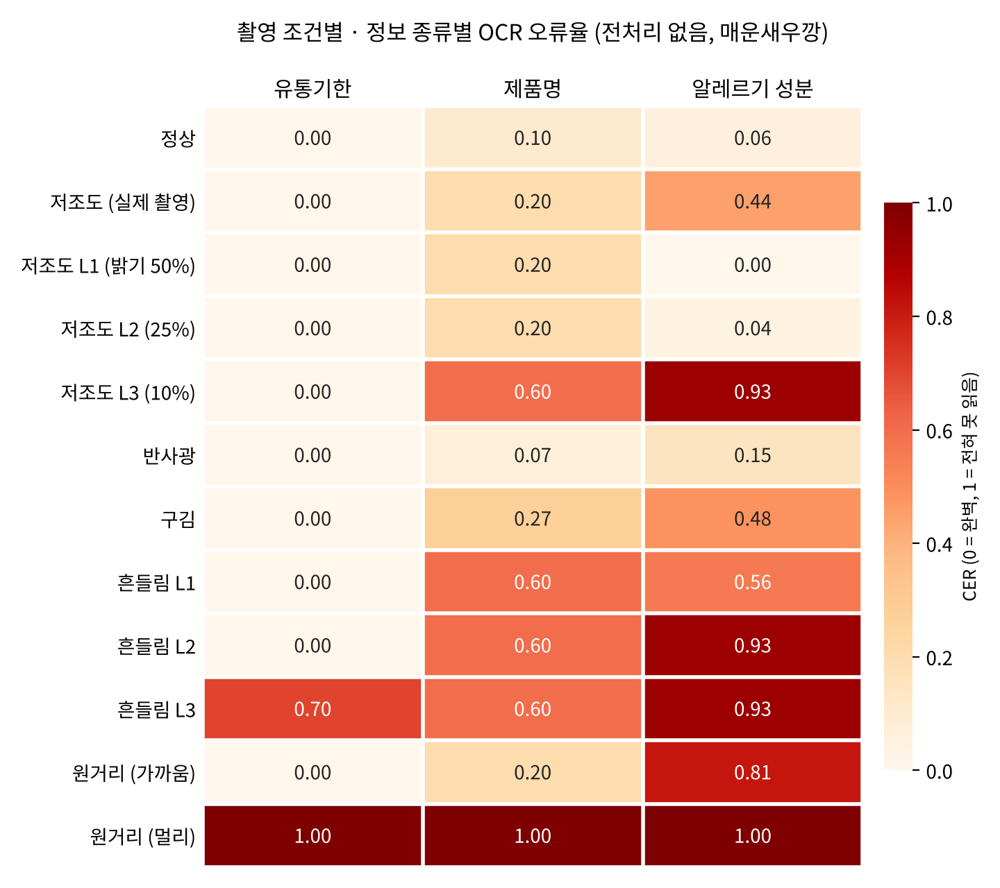

# AI 2 · 1주차 분석 결과: 촬영 환경별 OCR 오류와 전처리 효과

> 대상: 매운새우깡 1개 (직접 촬영 11장 + 코드 생성 6장) · OCR: PaddleOCR PP-OCRv5 한국어 · 작성: 배창현

**한 줄 요약:** 유통기한은 거의 모든 조건에서 정확히 읽었지만, **알레르기 성분은 반사광·구김·어두운 조명·흔들림에서 크게 틀렸고**, 1주차 OpenCV 전처리는 원거리(작은 글씨)를 제외하면 효과가 없거나 오히려 나빴습니다.

## 1. 발견한 것

### 유통기한은 강하고, 알레르기 성분은 약하다
- 유통기한(`2027.04.14 까지`)은 12개 조건 중 10개에서 **CER 0**으로 완벽하게 읽었습니다. 크고 굵은 검은 숫자가 무늬 없는 바탕에 인쇄되어 있기 때문입니다.
- 알레르기 성분은 성분표 안의 **작은 글씨**라서 조건이 조금만 나빠져도 틀렸습니다. 정상 사진에서도 CER 0.06이었고, 구김 0.48, 흔들림 0.56~0.93, 원거리 0.81까지 올라갔습니다.
- **가장 위험한 사례:** 반사광 사진(`p01_c2_2`)에서 빛이 성분표 윗줄을 덮어 `밀, 새우, 대두, 우유`를 통째로 놓쳤습니다. 숫자로는 CER 0.37이지만, 실제 사용이라면 **"이 제품에 새우가 없다"고 안내하는 위험 오분류**가 됩니다. 평균 CER보다 "어떤 성분을 놓쳤는가"를 따로 평가해야 하는 이유입니다(AI 3의 위험 오분류율 평가와 연결).

### 특정 글자를 반복해서 틀린다
- 제품명 `매운새우깡`의 **"깡"**을 거의 모든 사진에서 `깔`, `장`으로 읽거나 빼먹었습니다.
- 어두운 사진에서는 `밀→일`, `게→개`, `토마토→토마로`처럼 **모양이 비슷한 글자**로 바뀌었습니다.
- 이런 반복 오류는 전처리보다 **OCR 모델 학습(AI 1)**으로 해결할 문제입니다.

### 품질 측정값: 밝기·선명도는 구분되지만 반사광은 못 잡는다
| 조건 | 밝기 | 선명도 | 반사광 비율 |
|---|---|---|---|
| 정상 | 0.50 | 470 | 0.015 |
| 저조도 | **0.12** | 79 | 0 |
| 반사광 | 0.50 | 1059 | **0.007** |
| 흔들림 | 0.49 | **142** | 0.007 |

- 밝기와 선명도는 저조도·흔들림을 뚜렷하게 구분합니다. 사진 품질을 자동으로 판단해 "다시 찍어주세요"라고 안내하는 데 쓸 수 있습니다.
- 반면 **반사광 비율은 반사광 사진(0.007)이 정상 사진(0.015)보다 낮게** 나왔습니다. 흰 바탕과 반사광을 구분하지 못한 것이라, 반사광 검출 방법을 바꿔야 합니다.

## 2. 전처리 효과 (평균 CER, 전처리 전 → 후)

| 조건 | 적용한 전처리 | 전 | 후 | 결과 |
|---|---|---|---|---|
| 저조도 | 감마 + 노이즈 제거 + CLAHE | 0.217 | 0.312 | 나빠짐 |
| 반사광 | 반사광 인페인팅 + CLAHE | 0.072 | 0.072 | 변화 없음 |
| 흔들림 | 샤프닝 | 0.545 | 0.560 | 약간 나빠짐 |
| 구김 | CLAHE + 샤프닝 | 0.249 | 0.262 | 약간 나빠짐 |
| 원거리 | 확대 + 샤프닝 | 0.669 | 0.632 | **좋아짐** |

- **저조도가 나빠진 이유:** 밝기를 올리면서 어두운 사진의 노이즈까지 크게 키웠습니다(비교 이미지 `compare/p01_c1_1.jpg`에서 배경이 자글자글해진 것이 보임). 실제 촬영 사진에서 알레르기 CER이 0.44에서 0.89로 올랐습니다.
- **반사광이 그대로인 이유:** 하얗게 날아간 부분을 주변 색으로 메울 수는 있어도, 그 밑에 있던 글자는 되살릴 수 없습니다.
- **흔들림이 그대로인 이유:** 샤프닝은 경계를 진하게 할 뿐 번진 글자를 되돌리지 못합니다.
- **원거리만 좋아진 이유:** 작은 글자를 키우면 OCR이 읽는 글자 조각이 커져서 인식이 나아졌습니다(가까운 원거리 사진의 알레르기 CER 0.81 → 0.59).

## 3. 2주차 개선 방향

1. **원거리·작은 글씨:** 사진에서 패키지 부분만 잘라내 확대한 뒤 OCR에 넣기. 유일하게 효과가 확인된 방향이고, 아주 먼 사진(글자 0개 검출)도 살릴 가능성이 있습니다.
2. **저조도:** 밝히기 전에 노이즈를 더 강하게 제거하거나, 딥러닝 저조도 개선 모델과 비교하기.
3. **흔들림·반사광:** 전처리로는 한계가 뚜렷하므로, 품질 측정값으로 감지해서 **재촬영 안내**로 해결하는 방향을 AI 4와 논의. 반사광 검출 방법도 개선 필요.
4. **실험 규모:** 제품을 15~20개로, 포장 종류(상자, 캔, 컵)를 다양하게 늘려서 결론의 신뢰도 높이기.

## 4. 한계

- 제품이 1개뿐이라 경향을 보는 수준이며, 결론을 내리려면 제품을 늘려야 합니다.
- 메모리 부족을 피하려고 OCR의 글자 찾기 단계에서 사진을 최대 1280픽셀로 줄였습니다. 아주 먼 사진에서 글자를 하나도 못 찾은 데에는 이 설정도 영향을 줬을 수 있습니다.
- 사진은 업로드 과정에서 1512×2016으로 줄어든 버전을 사용했습니다.
