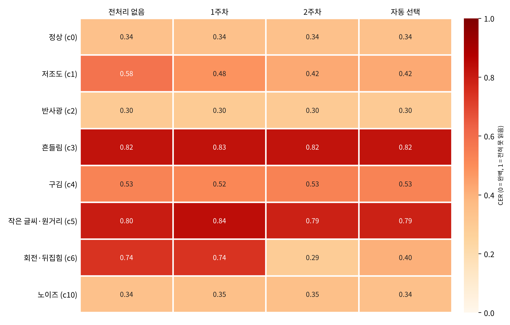
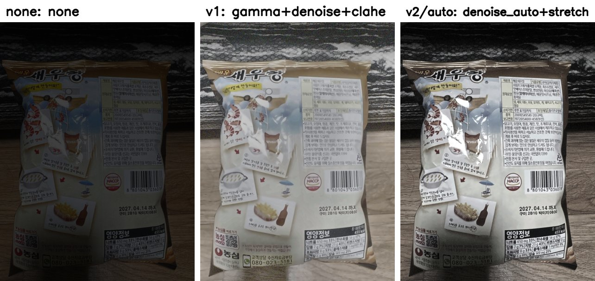
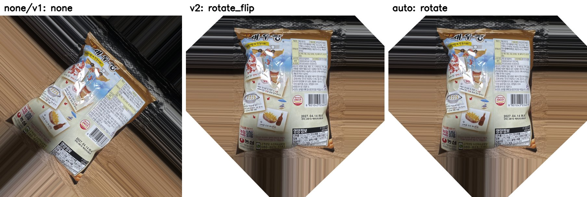

# AI 2 2주차 결과: 명암·회전·노이즈 보정과 전처리 전후 OCR 비교

담당: 배창현 (AI 2, 이미지 전처리)

## 한 줄 요약

**회전 보정과 저조도 보정은 효과가 뚜렷했고, 노이즈·구김 보정은 효과가 없었습니다.** 흔들림·원거리·너무 어두운 사진은 전처리로 살리기 어려워서, 품질 진단(`assess_quality`)이 **재촬영 안내 문구**를 만들어 AI 4에 넘기도록 했습니다.

## 실험 방법

- 사진: 새우깡(p01) 직접 촬영 11장 + 정상 사진으로 만든 저조도 3장, 흔들림 3장, 회전 4장(15°, 45°, 90°, 180°), 노이즈 3장 = **24장**
- 비교한 방식 4가지

  | 방식 | 설명 |
  |---|---|
  | 전처리 없음 (`none`) | 원본 그대로 |
  | 1주차 (`v1`) | 1주차 조건별 조합 |
  | 2주차 (`v2`) | 이번 주에 만든 조건별 조합 |
  | 자동 선택 (`auto`) | 사진 품질을 진단해서 전처리를 자동으로 고름. **실제 서비스에서 쓰는 방식** (조건 이름을 모르는 상태) |

- 평가: 유통기한·제품명·알레르기 성분 정답 라벨과의 글자 오류율(CER) 평균. 0이면 완벽, 1이면 전혀 못 읽음
- OCR 엔진: **EasyOCR로 사전 실험**한 결과입니다. 팀 기준 엔진인 PaddleOCR 결과는 Colab에서 `notebooks/ai2_week2_preprocess.ipynb`를 실행해 `paddle/` 폴더에 추가합니다.

## 결과: 조건별 평균 CER

| 조건 | 사진 수 | 전처리 없음 | 1주차 | 2주차 | 자동 선택 | 판단 |
|---|---|---|---|---|---|---|
| 정상 (c0) | 2 | 0.34 | 0.34 | 0.34 | 0.34 | 기준선. 자동 선택이 정상 사진을 망가뜨리지 않음 |
| **저조도 (c1)** | 4 | 0.58 | 0.48 | **0.42** | **0.42** | **개선** (1주차보다도 좋음) |
| 반사광 (c2) | 3 | 0.30 | 0.30 | 0.30 | 0.30 | 변화 없음, 진단도 안 됨 |
| 흔들림 (c3) | 3 | 0.82 | 0.83 | 0.82 | 0.82 | 복구 불가 → 재촬영 안내 (3장 모두 감지) |
| 구김 (c4) | 3 | 0.53 | 0.52 | 0.53 | 0.53 | 효과 없음 |
| 작은 글씨·원거리 (c5) | 2 | 0.80 | 0.84 | 0.79 | 0.79 | 거의 효과 없음 → 재촬영 안내 (2장 모두 감지) |
| **회전·뒤집힘 (c6)** | 4 | 0.74 | 0.74 | **0.29** | 0.40 | **크게 개선** (정상 사진 수준) |
| 노이즈 (c10) | 3 | 0.34 | 0.35 | 0.35 | 0.34 | 효과 없음 (원래부터 잘 읽힘) |

## 보정별 분석

### 1. 명암 보정 (저조도)

| 사진 | 전처리 없음 | 1주차 | 2주차 |
|---|---|---|---|
| 조금 어두움 (L1) | 0.31 | 0.42 | **0.29** |
| 어두움 (L2) | 0.48 | 0.41 | **0.29** |
| 매우 어두움 (L3) | 1.00 | **0.56** | 0.64 |
| 실제 어두운 곳 촬영 | 0.54 | 0.54 | **0.46** |

- **어두움(L2) 사진은 정상 사진과 같은 수준(0.29)까지 돌아왔고**, 알레르기 성분 오류율이 0.85 → 0.48로 줄었습니다.
- 1주차 조합(감마 → 노이즈 제거 → CLAHE)은 밝히는 과정에서 노이즈를 먼저 키운 뒤 지워서, 조금 어두운 사진(L1)은 오히려 나빠졌습니다. 2주차는 **노이즈를 먼저 약하게 지우고, 밝기 채널만 늘이는**(stretch) 순서로 바꿨습니다.
- 매우 어두운 사진(L3)은 1주차 방식이 조금 더 나았지만 둘 다 0.5 이상이라 실사용이 어렵습니다. 그래서 품질 진단이 **"너무 어두움 → 재촬영"**으로 판단하도록 했습니다.
- 사전 실험에서 비교한 후보: 밝기 보정(`brighten`) 0.46, 밝기 보정 + 약한 CLAHE 0.42, **명암 늘이기(`stretch`) 0.41** → stretch 채택

### 2. 회전 보정

| 회전 | 전처리 없음 | 2주차 | 보정 각도 |
|---|---|---|---|
| 15° | 0.47 | **0.25** | 346° (= -14°) |
| 45° | 0.81 | **0.37** | 316° (= -44°) |
| 90° | 0.92 | **0.23** | 271° (= -89°) |
| 180° (뒤집힘) | 0.76 | **0.29** | 180° |

- 방법: ① 글자 줄의 방향으로 기울기를 추정하고 ② "그대로 / 되돌리기 / 180° 뒤집기" 후보를 작은 사진으로 OCR해서 **가장 잘 읽히는 방향을 고릅니다**. ③ 돌리면서 생긴 빈 여백은 잘라냅니다.
- 네 각도 모두 정상 사진(0.29)과 비슷한 수준까지 회복했습니다. 90° 사진은 제품명 오류율이 1.0 → 0.2, 유통기한이 0.8 → 0으로 바뀌었습니다.
- **OCR로 확인하는 단계가 꼭 필요했습니다.** 기울기 추정만 쓰면 바닥 나뭇결을 글자 줄로 착각해 -75°로 잡는 등, 실제로는 똑바른 사진 4장을 기울었다고 판단했습니다. OCR 확인 덕분에 4장 모두 돌리지 않고(0°) 그대로 두었습니다.
- 자동 선택(0.40)이 2주차(0.29)보다 높은 이유: 자동 선택은 시간을 아끼려고 **180° 뒤집힘은 확인하지 않습니다.** 뒤집힌 사진은 OCR 확신도가 매우 낮게 나오므로, 그때만 뒤집어서 다시 읽는 처리를 AI 4 쪽 흐름에 넣는 것을 제안합니다.

### 3. 노이즈 보정

| 노이즈 세기 | 전처리 없음 | 1주차 (고정 세기) | 2주차 (자동 세기) |
|---|---|---|---|
| 약함 (σ 10) | 0.29 | 0.31 | 0.31 |
| 중간 (σ 20) | 0.33 | 0.33 | **0.32** |
| 강함 (σ 35) | **0.40** | 0.41 | 0.42 |

- 노이즈 세기를 자동으로 재는 기능(`noise_sigma`)은 잘 동작했습니다(σ 10 → 3.1, σ 20 → 5.6, σ 35 → 9.1로 단계별 구분됨).
- 하지만 **노이즈를 지워도 OCR은 좋아지지 않았습니다.** 딥러닝 OCR은 학습 때 노이즈 섞인 사진을 많이 봐서 노이즈에 강하고, 노이즈를 지우면 가는 글자 획까지 같이 흐려지기 때문으로 보입니다. 사전 실험에서 양방향 필터, 미디언 필터도 비교했지만 마찬가지였습니다.
- 그래서 노이즈 제거는 **저조도 보정의 첫 단계로만** 약하게 쓰고, 노이즈 단독으로는 PaddleOCR 결과를 보고 뺄지 정합니다.

### 4. 구김 (조명 평탄화)

- 사진을 크게 흐린 "배경 밝기"로 나눠 주름 음영을 지우는 방법(`illumination`)을 시도했지만 0.53 → 0.53으로 변화가 없었습니다.
- 구김 사진의 오류는 음영보다 **글자 자체가 접혀서 휘어진 것**이 원인이라, 밝기 보정으로는 해결되지 않습니다. 3주차에 PaddleOCR의 문서 펴기 옵션(`use_doc_unwarping`)과 비교할 예정입니다.

## 품질 진단 (`assess_quality`) 결과

24장 중 **8장에 재촬영 안내**가 나왔고, 8장 모두 전처리 후에도 오류율이 0.46 이상(정상 사진 0.29)인 사진이었습니다.

| 진단 | 사진 | 안내 문구 (AI 4가 음성으로 읽음) |
|---|---|---|
| 너무 어두움 | 실제 어두운 곳 촬영, L3 | 사진이 너무 어둡습니다. 밝은 곳에서 다시 찍어 주세요. |
| 흔들림 | 흔들림 L1, L2, L3 | 사진이 흔들렸습니다. 휴대폰을 잠시 멈춘 채로 다시 찍어 주세요. |
| 너무 멂 | 원거리 2장 | 글자가 너무 작게 찍혔습니다. 제품에 조금 더 가까이 대고 찍어 주세요. |

- 흔들림 판단에 쓴 **선명도 지수**(선명도 ÷ 대비²)는 정상 0.10 이상, 흔들림 0.02~0.04로 뚜렷하게 나뉘었습니다.
- **반사광은 진단하지 못했습니다.** 휴대폰 카메라가 밝은 부분을 부드럽게 처리해서, 반사광이 하얗게 날아간 점이 아니라 글자 위 뿌연 막처럼 찍히기 때문입니다. 1주차 PaddleOCR 실험에서는 반사광 때문에 알레르기 성분("밀, 새우, 대두, 우유")이 빠졌으므로, **OCR 확신도가 낮은 글자 줄이 많으면 재촬영을 안내**하는 방식을 AI 4와 논의하겠습니다.

## 모듈 연결 확인

`preprocessing/pipeline.py`로 **사진 → 품질 진단 → 전처리 → OCR → JSON**이 한 번에 동작하는 것을 확인했습니다. 샘플 출력은 `easyocr/sample_output/`에 있습니다.

| 샘플 | 진단 | 전처리 | 재촬영 안내 |
|---|---|---|---|
| `p01_c0_1.json` (정상) | 없음 | 없음 | 없음 |
| `p01_c1_1.json` (실제 어두운 곳) | 너무 어두움 | 노이즈 제거 + 명암 늘이기 | 있음 |
| `p01_c6_L2.json` (45° 회전) | 기울어짐 | 회전 보정 (316°) | 없음 |
| `p01_c5_1.json` (원거리) | 너무 멂 | 확대 | 있음 |

- **AI 3(이서영):** JSON의 `ocr` 목록이 `docs/interface.md`의 OCR 출력 형식과 같아서 `extract()` 입력으로 바로 쓸 수 있습니다.
- **AI 4(박세준):** `quality.retake`가 `true`면 `quality.advice` 문장을 먼저 읽어 주면 됩니다.
- 처리 시간(개발용 환경 CPU 2개, EasyOCR 기준): 사진 한 장에 평균 23초, 회전 보정이 들어가면 최대 45초. PaddleOCR 기준 시간은 Colab 실행 후 추가합니다.

## 한계와 다음 할 일

- 제품이 새우깡 1개뿐이고, 저조도·흔들림·회전·노이즈는 코드로 만든 사진입니다. 3주차에 제품을 늘려 다시 확인해야 합니다.
- 이번 결과는 EasyOCR 기준입니다. **PaddleOCR로 같은 실험을 Colab에서 돌려** 조합을 최종 확정합니다.
- 다음 주 후보: 반사광 재촬영 판단(OCR 확신도 기준), 뒤집힘 자동 확인, 구김 사진에 문서 펴기 옵션 비교
