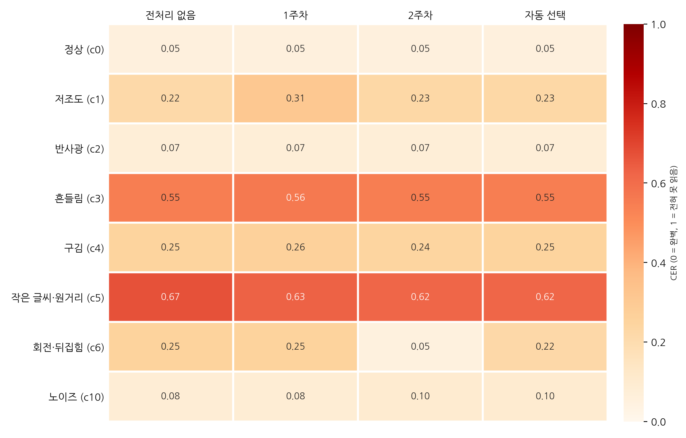
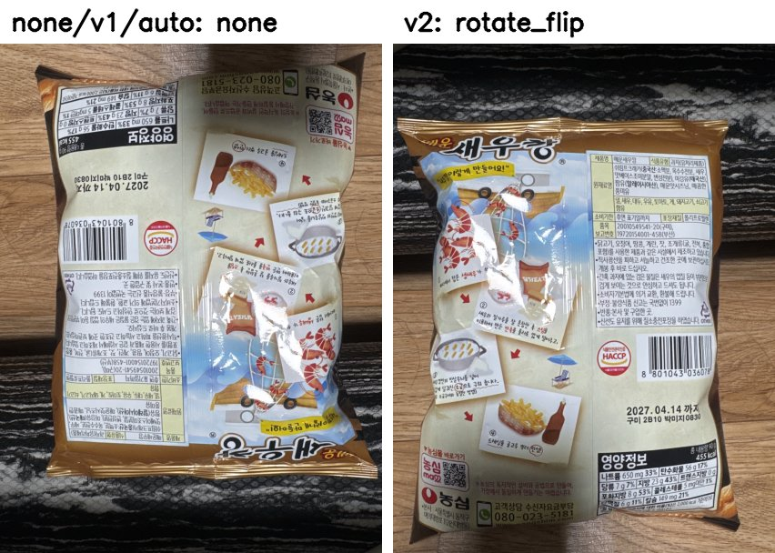
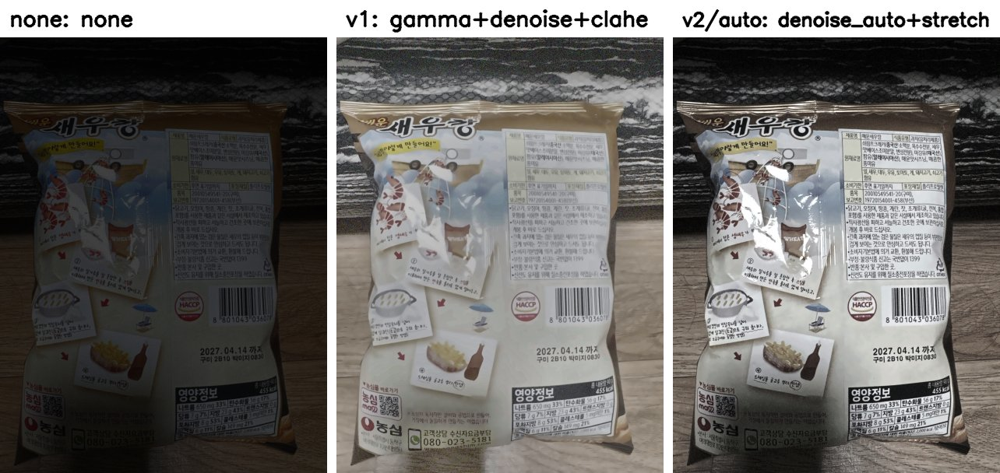

# AI 2 2주차 결과: 명암·회전·노이즈 보정과 전처리 전후 OCR 비교

담당: 배창현 (AI 2, 이미지 전처리)

## 한 줄 요약

팀 기준 엔진인 **PaddleOCR은 생각보다 강해서**, 정상·반사광·노이즈·조금 어두운 사진은 전처리 없이도 잘 읽었습니다(오류율 0.05~0.08). 차이를 만든 것은 다음 두 가지입니다.

1. **회전·뒤집힘 보정:** 뒤집힌 사진의 오류율이 0.75에서 0.07로 내려갔습니다.
2. **OCR 확신도:** 사진이 잘 찍혔는지를 가장 잘 알려 주는 값이었습니다. 이를 이용해 자동 처리 흐름(`pipeline.run_pipeline`)을 "확신도가 낮을 때만 방향을 다시 확인하고, 그래도 낮으면 재촬영 안내"로 바꿨습니다.

저조도·노이즈·구김 보정은 효과가 작거나 오히려 나빠서 자동 처리에서 빼거나 줄였습니다.



## 실험 방법

- 사진은 모두 **24장**입니다.
  - 새우깡(p01) 직접 촬영 11장
  - 정상 사진으로 코드에서 만든 사진 13장: 저조도 3장, 흔들림 3장, 회전 4장(15°, 45°, 90°, 180°), 노이즈 3장
- 비교한 방식은 4가지입니다.

  | 방식 | 설명 |
  |---|---|
  | 전처리 없음 (`none`) | 원본 그대로 |
  | 1주차 (`v1`) | 1주차 조건별 조합 |
  | 2주차 (`v2`) | 이번 주에 만든 조건별 조합 (조건 이름을 안다고 가정) |
  | 자동 선택 (`auto`) | 조건을 모르는 상태에서 사진만 보고 처리. **실제 서비스에서 쓰는 방식** |

- 평가는 유통기한·제품명·알레르기 성분 정답 라벨과의 글자 오류율(CER) 평균입니다. 0이면 완벽, 1이면 전혀 못 읽음입니다.
- OCR 엔진은 **PaddleOCR**(Colab CPU)이고, 결과는 `paddle/` 폴더에 있습니다. 개발 중에는 EasyOCR로 사전 실험을 했고, 그 결과는 `easyocr/` 폴더에 있습니다.

## 결과: 조건별 평균 CER (PaddleOCR)

| 조건 | 사진 수 | 전처리 없음 | 1주차 | 2주차 | 자동 (측정) | **자동 개선판 (계산)** |
|---|---|---|---|---|---|---|
| 정상 (c0) | 2 | 0.05 | 0.05 | 0.05 | 0.05 | 0.05 |
| 저조도 (c1) | 4 | 0.22 | 0.31 | 0.23 | 0.23 | **0.20** |
| 반사광 (c2) | 3 | 0.07 | 0.07 | 0.07 | 0.07 | 0.07 |
| 흔들림 (c3) | 3 | 0.55 | 0.56 | 0.55 | 0.55 | 0.55 → 재촬영 안내 |
| 구김 (c4) | 3 | 0.25 | 0.26 | 0.25 | 0.25 | 0.25 |
| 작은 글씨·원거리 (c5) | 2 | 0.67 | 0.63 | 0.62 | 0.62 | 0.62 → 재촬영 안내 |
| **회전·뒤집힘 (c6)** | 4 | 0.25 | 0.25 | **0.05** | 0.22 | **0.07** |
| 노이즈 (c10) | 3 | 0.08 | 0.08 | 0.10 | 0.10 | **0.08** |
| **전체 평균** | 24 | 0.256 | | 0.222 | 0.251 | **0.219** |

- "자동 (측정)"은 Colab에서 돌린 처음 버전입니다. 180° 뒤집힘을 확인하지 않았고, 노이즈 사진도 노이즈를 지웠습니다.
- "자동 개선판 (계산)"은 이 결과를 보고 고친 버전으로, **위 실측값을 그대로 조합해 계산한 값**입니다(아래 "자동 처리 개선" 참고).
  - 개선판은 조건을 모르는 상태에서도 조건을 아는 2주차 조합(0.222)만큼 좋습니다.
  - **모든 조건에서 전처리 없음보다 같거나 좋습니다.**

## 보정별 분석

### 1. 회전 보정: 효과가 가장 큼

| 회전 | 전처리 없음 | 2주차 | 보정 각도 | OCR 확신도 (전 → 후) |
|---|---|---|---|---|
| 15° | 0.07 | 0.07 | 346° (= -14°) | 0.91 → 0.93 |
| 45° | 0.09 | **0.00** | 316° (= -44°) | 0.86 → 0.91 |
| 90° | 0.09 | 0.07 | 271° (= -89°) | 0.77 → 0.91 |
| **180° (뒤집힘)** | **0.75** | **0.07** | 180° | **0.44 → 0.93** |



- PaddleOCR은 15°~90° 기울어진 글자는 스스로 꽤 잘 읽습니다. 그래서 기울기 보정의 효과는 작았습니다(0.09 → 0.07 정도).
- **뒤집힌 사진은 거의 못 읽었습니다(제품명 0.8, 유통기한 0.5 오류).** 시각장애인은 화면을 볼 수 없어서 제품을 거꾸로 들고 찍기 쉬우므로, 이 보정이 가장 중요합니다.
- 방법은 세 단계입니다.
  1. 글자 줄 방향으로 기울기를 추정합니다.
  2. "그대로 / 되돌리기 / 180° 뒤집기" 후보를 작은 사진으로 OCR해서 가장 잘 읽히는 방향을 고릅니다.
  3. 돌리면서 생긴 빈 여백을 잘라냅니다.
- 기울기 추정만으로는 믿기 어렵습니다. 똑바른 사진 20장 중 4장을 바닥 나뭇결 때문에 "기울어짐"으로 잘못 판단했습니다(예: -75°). OCR로 확인하는 단계 덕분에 4장 모두 돌리지 않았습니다.
- 처음 자동 선택(측정 0.22)은 시간을 아끼려고 뒤집힘을 확인하지 않아서 180° 사진을 놓쳤습니다. 이것을 OCR 확신도로 해결했습니다(아래).

### 2. 명암 보정 (저조도): 엔진에 따라 결과가 다름

| 사진 | 전처리 없음 | 1주차 | 2주차 |
|---|---|---|---|
| 조금 어두움 (L1) | 0.07 | 0.01 | **0.00** |
| 어두움 (L2) | 0.08 | 0.26 | **0.07** |
| 매우 어두움 (L3) | 0.51 | 0.48 | 0.50 |
| 실제 어두운 곳 촬영 | **0.21** | 0.50 | 0.34 |



- **1주차 방식은 확실히 해로웠습니다.** 알레르기 성분 오류율이 0.35에서 0.54로 올랐습니다. 밝히면서 노이즈를 먼저 키우는 순서 때문입니다.
- 2주차 방식(노이즈 먼저 약하게 제거 → 밝기 채널만 늘이기)은 조금 어두운 사진을 조금 좋게 만들었습니다. 하지만 **실제로 아주 어두운 곳에서 찍은 사진은 오히려 나빠졌습니다**(알레르기 성분 0.44 → 0.81).
- 그래서 규칙을 이렇게 바꿨습니다.
  - **어두움 → 2주차 보정**
  - **너무 어두움 → 보정하지 않고 재촬영 안내**
- EasyOCR 사전 실험에서는 같은 보정이 오류율을 0.58에서 0.42로 크게 낮췄습니다. **OCR이 약할수록 전처리 효과가 크고, 강한 OCR에는 작습니다.** AI 1이 OCR 모델을 바꾸면 이 판단도 다시 확인해야 합니다.

### 3. 노이즈 보정: 효과 없음 → 자동 처리에서 제외

| 노이즈 세기 | 전처리 없음 | 1주차 (고정 세기) | 2주차 (자동 세기) |
|---|---|---|---|
| 약함 (σ 10) | 0.07 | 0.00 | 0.07 |
| 중간 (σ 20) | 0.07 | 0.07 | 0.07 |
| 강함 (σ 35) | **0.10** | 0.18 | 0.16 |

- 노이즈 세기를 자동으로 재는 기능은 잘 동작했습니다. σ 10, 20, 35를 각각 3.1, 5.6, 9.1로 단계별로 구분했습니다.
- 그러나 PaddleOCR은 노이즈에 강해서 지울 필요가 없었습니다. 강한 노이즈를 지우면 가는 글자 획까지 흐려져서 0.10에서 0.16으로 오히려 나빠졌습니다.
- 그래서 노이즈는 **진단만 하고 지우지 않도록** 바꿨습니다. 노이즈 제거는 저조도 보정의 첫 단계로만 씁니다.

### 4. 구김, 원거리

- **구김:** 주름 음영을 지우는 조명 평탄화(`illumination`)는 효과가 없었습니다(0.249 → 0.245). 원인은 음영이 아니라 글자 자체가 접혀서 휜 것이라, 3주차에 PaddleOCR의 문서 펴기 옵션과 비교하겠습니다.
- **원거리:** 확대(`upscale`)가 알레르기 성분을 조금 살렸습니다(0.81 → 0.52). 하지만 여전히 높아서 재촬영 안내를 함께 합니다. 아주 먼 사진(c5_2)은 글자를 하나도 찾지 못했습니다.

## 새로 알게 된 것: OCR 확신도가 사진 품질을 가장 잘 알려 준다

PaddleOCR은 글자 줄마다 "얼마나 확신하는지"(score)를 같이 줍니다. 이 값의 평균을 사진별로 보면 다음과 같습니다.

| OCR 확신도 (전처리 없음) | 사진 | 오류율 |
|---|---|---|
| 0.90 이상 | 정상 2장, 조금 어두움, 약한 노이즈, 15° 회전, 반사광 1장 (6장) | 0.04~0.12 |
| 0.80~0.90 | 반사광 2장, 구김 3장, 노이즈 2장, 어두움, 45° 회전 (9장) | 0.00~0.28 |
| **0.80 미만** | 흔들림 3장, 원거리 2장, 너무 어두움 2장, **뒤집힘**, 90° 회전 (9장) | **7장이 0.34 이상** (나머지는 실제 어두운 사진 0.21, 90° 회전 0.09) |

- 픽셀 계산(밝기·선명도)으로는 잡지 못한 **뒤집힘도 확신도로는 바로 드러났습니다**(0.44, 정상은 0.92).
- OCR은 어차피 돌려야 하므로, 이 값을 쓰는 데 추가 비용이 없습니다.

## 자동 처리 개선 (`pipeline.run_pipeline`)

```
사진 → 품질 진단 → 전처리(어두움: 밝기 보정 / 원거리: 확대) → OCR
          │
          └ OCR 확신도 0.8 미만? ─ 예 → 회전·뒤집힘 후보 확인 → 더 잘 읽히면 그 방향으로 다시 OCR
                                       └ 그래도 0.7 미만이면 재촬영 안내
```

- 확신도가 높은 사진(24장 중 15장)은 방향 확인을 건너뜁니다. 처음 버전은 기울기 추정이 틀린 사진에도 방향 확인을 해서 한 장에 2분 넘게 걸렸는데, 그런 낭비가 없어집니다.
- 표의 "자동 개선판 (계산)" 값은 다음처럼 Colab 실측 결과를 조합해 구했습니다.
  - 전처리 결과는 같은 조합의 실측값을 그대로 썼습니다.
  - 방향 확인 결과는 2주차 `rotate_flip` 실측값을 그대로 썼습니다.
  - 확신도가 낮은 똑바른 사진 7장은 방향 확인 후에도 0°가 유지된다고 가정했습니다. 이번 실험에서 OCR로 방향을 확인한 똑바른 사진 6장은 한 장도 잘못 돌아가지 않았습니다.
  - 3주차 Colab 실행에서 이 개선판을 직접 측정합니다.

## 품질 진단과 재촬영 안내

개선판 기준으로 24장 중 **7장에 재촬영 안내**가 나옵니다. 7장 모두 오류율 0.21 이상이고(정상 사진은 0.05), 그중 4장은 0.5 이상입니다.

| 진단 | 사진 | 안내 문구 (AI 4가 음성으로 읽음) |
|---|---|---|
| 너무 어두움 | 실제 어두운 곳 촬영, L3 | 사진이 너무 어둡습니다. 밝은 곳에서 다시 찍어 주세요. |
| 흔들림 | 흔들림 L1, L2, L3 | 사진이 흔들렸습니다. 휴대폰을 잠시 멈춘 채로 다시 찍어 주세요. |
| 너무 멂 | 원거리 2장 | 글자가 너무 작게 찍혔습니다. 제품에 조금 더 가까이 대고 찍어 주세요. |
| OCR 확신도 낮음 | (이번 사진 중에는 없음) | 글자가 잘 읽히지 않습니다. 빛 반사가 없는 밝은 곳에서 제품을 펴서 다시 찍어 주세요. |

**남은 위험: 반사광 사진 `p01_c2_2`**

- 1주차와 마찬가지로, 빛이 성분표 윗줄을 덮어 `밀, 새우, 대두, 우유`를 놓쳤습니다(알레르기 성분 오류율 0.37).
- 그런데 이 사진의 확신도는 0.90으로 높습니다. OCR은 보이는 글자를 자신 있게 읽었고, 가려진 줄은 아예 찾지 못했기 때문입니다. 그래서 **품질 진단으로도 확신도로도 잡히지 않습니다.**
- 제안: **AI 3이 알레르기 성분 줄을 찾지 못하면 "알레르기 정보가 보이지 않습니다. 각도를 바꿔 다시 찍어 주세요"라고 안내하도록** AI 3·AI 4와 논의하겠습니다.

## 모듈 연결

`preprocessing/pipeline.py`로 **사진 → 품질 진단 → 전처리 → OCR → JSON**이 한 번에 동작합니다. 샘플 출력은 두 곳에 있습니다.

- `paddle/sample_output/`: PaddleOCR 결과. 개선 전 버전으로 만들어서 `ocr_confidence` 필드가 없습니다.
- `easyocr/sample_output/`: 개선판 결과. 뒤집힌 사진 예시(`p01_c6_L4.json`)를 포함합니다.

팀원별로 이렇게 쓰면 됩니다.

- **AI 1 (이도현):** 사진을 받아서 `[{text, box, score}]` 목록을 돌려주는 함수면 어떤 OCR이든 그대로 연결됩니다.
- **AI 3 (이서영):** JSON의 `ocr` 목록을 `extract()` 입력으로 바로 쓸 수 있습니다.
- **AI 4 (박세준):** `quality.retake`가 `true`면 `quality.advice` 문장을 먼저 읽어 주면 됩니다.

**처리 시간**은 Colab 무료 CPU, PaddleOCR 기준으로 사진 한 장에 약 1분(전처리 없음 평균 57초)입니다. 방향 확인이 붙으면 더 걸리므로, **웹 데모는 Colab GPU 런타임**에서 돌리는 것을 권장합니다.

## 한계와 다음 할 일 (3주차)

- 제품이 새우깡 1개뿐이고, 저조도·흔들림·회전·노이즈는 코드로 만든 사진입니다. AI 1의 데이터로 제품을 늘려 다시 확인합니다.
- 자동 처리 개선판을 Colab에서 직접 측정합니다(이번 표는 계산값).
- 반사광으로 성분 줄이 사라지는 경우를 AI 3과 함께 처리합니다.
- 구김 사진에 PaddleOCR 문서 펴기 옵션(`use_doc_unwarping`)을 비교합니다.
